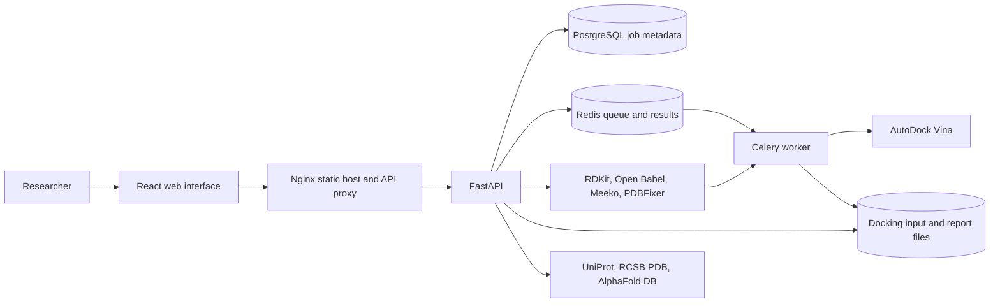
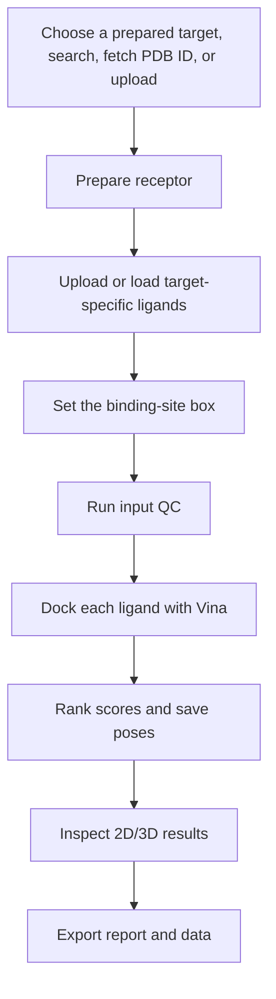

# DockLab

DockLab is a molecular docking workbench built around AutoDock Vina. It lets a researcher prepare a protein receptor and small molecules, check inputs, run docking, inspect poses and scores, and export a report. Docking scores are computational estimates; they are not probabilities of activity or experimental evidence.

## Project status

The repository contains the DockLab application, local Docker configuration, and a deployed public Render preview. GitHub stores the source; Render runs the application and docking API.

**Live website:** [https://doclabs.onrender.com](https://doclabs.onrender.com)

## Features

- Start with bundled HIV-1 protease (1HSG) and EGFR kinase (1M17) case studies.
- Search UniProt, RCSB PDB, and AlphaFold DB for public protein structures without an API key.
- Fetch an experimental structure by PDB ID or upload a PDB/ENT receptor file.
- Upload ligand CSV files (`name,smiles,label`) or whitespace-delimited SMI files.
- Prepare receptors and ligands, run pre-docking quality checks, and set the binding-site search box.
- Dock with AutoDock Vina; review ranked scores, 2D ligand depictions, and 3D receptor/pose views.
- Export results and reports in supported formats (HTML, CSV, SDF, ZIP; PDF where its renderer is available).
- Run the two-target benchmark and inspect the separately documented archived pose-validation example.

## System architecture



In Docker Compose, the browser talks to Nginx on port 3000. Nginx serves the React app and forwards `/api/...` requests to FastAPI on the private Compose network. FastAPI records jobs in PostgreSQL and queues docking tasks through Redis; Celery workers run Vina and save outputs for the API to report. Public structure searches and PDB downloads use the respective public data services.

### Docking workflow



Searching/fetching a protein supplies a structure, not a ready screening experiment. For a newly selected protein, users must supply ligands and locate the binding-site box. The bundled case studies include curated ligand sets. “Active” and “decoy” labels refer to molecules in a particular target study, not to proteins.

## Run locally with Docker Compose

Requirements: Docker Desktop with Docker Compose. Create the local environment file and set a long, URL-safe password before starting:

```powershell
Copy-Item .env.example .env
python -c "import secrets; print(secrets.token_hex(32))"
```

Put the generated value in `POSTGRES_PASSWORD` in `.env`. Do not commit `.env`; only `.env.example` belongs in the repository. Then run:

```powershell
docker compose up --build
```

Open [http://localhost:3000](http://localhost:3000). The workbench is at [http://localhost:3000/workbench/](http://localhost:3000/workbench/), benchmark at [http://localhost:3000/benchmark/](http://localhost:3000/benchmark/), and API documentation at [http://localhost:3000/docs](http://localhost:3000/docs). Nginx proxies the API paths on the same origin; the database, Redis, and API ports are not published to the host.

Stop the services with `Ctrl+C`. Use `docker compose down` to stop and remove the containers while retaining named database and docking-data volumes. `docker compose down -v` also deletes those volumes.

## Local Windows development

Use the `docklab` Conda environment from `environment.yml`. In one PowerShell terminal, from the project root:

```powershell
$env:DATA_DIR = (Join-Path (Get-Location) 'data')
$env:DATABASE_URL = 'sqlite:///./docklab.db'
$env:DOCKLAB_USE_CELERY = '0'
python -m uvicorn backend.app.main:app --host 127.0.0.1 --port 8001
```

In a second terminal:

```powershell
Set-Location frontend
npm install
npm run dev
```

Open [http://localhost:5173](http://localhost:5173). Vite proxies `/api` to the local API on port 8001. The lightweight static preview in `frontend/local` is served separately on port 3000 and also expects the local API on 8001.

## Public preview deployment

The repository includes a Render Blueprint for a single-service preview. To create your own instance, open [Deploy DockLab on Render](https://render.com/deploy?repo=https%3A%2F%2Fgithub.com%2Fbhumiahuja1617-design%2Fdoclabs) and follow Render's setup steps. The shared demonstration is available at [https://doclabs.onrender.com](https://doclabs.onrender.com).

The Blueprint uses a free web service and SQLite in temporary storage for an initial demonstration. Free services can sleep/restart and local files can be lost, so this setup is not suitable for persistent research records or dependable long docking runs. For durable/public use, deploy the Docker Compose architecture on an appropriately sized host, configure persistent volumes and backups, and protect the API against unwanted job submissions before opening it to everyone. Check current [Render free-service limitations](https://render.com/docs/free) before deployment.

## Data, privacy, and scientific limitations

- Public protein search uses UniProtKB, RCSB PDB, and AlphaFold DB. RCSB entries are experimental structures; AlphaFold entries are predictions and are identified as such.
- Uploaded structures and ligands are processed by the DockLab server. Do not upload confidential or controlled research data to a public deployment.
- Local development stores temporary jobs under `data/`; the Compose configuration stores database and docking artifacts in named volumes.
- A docking score is a scoring-function estimate. Results depend on receptor preparation, ligand protonation/tautomer state, selected chains, box placement, and search settings. Docking does not establish binding or efficacy; validate promising results experimentally and with appropriate controls.
- User-supplied proteins need a correctly placed binding-site box and ligands before the run is meaningful. An arbitrary 20 Å box at the origin is only a starting value.
- PDF export depends on WeasyPrint and its native libraries; HTML and data exports are available as alternatives.

## Tests and benchmark

Run the backend tests from the project root in the `docklab` environment:

```powershell
python -m pytest backend/tests
```

See [`docs/PLAN.md`](docs/PLAN.md), [`docs/DECISIONS.md`](docs/DECISIONS.md), [`docs/BUILD-LOG.md`](docs/BUILD-LOG.md), and [`docs/case_study/`](docs/case_study/) for implementation decisions and scientific provenance. Benchmark outputs should be generated by `python benchmark/run_benchmark.py --help`; archived pose-validation figures are not fresh screening measurements.
